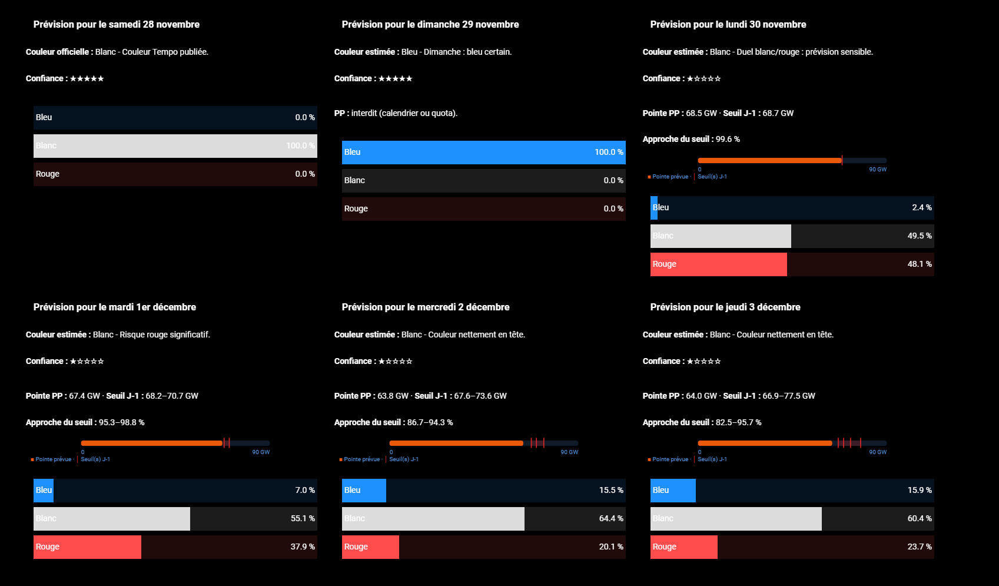

# Météo Tempo (Home Assistant) — Prévision J+1 à J+6

Projet personnel de prévision des couleurs Tempo (bleu, blanc, rouge), conçu pour aider à anticiper les consommations électriques et à adapter les automatisations de Home Assistant.

**Version 2.1.0 — novembre 2026**

> ⚠️ Ce projet ne remplace pas l'annonce officielle Tempo. Il fournit des estimations probabilistes, susceptibles d'évoluer au fil des publications RTE et de la météo. Le modèle V2 est en cours d'évaluation en conditions réelles ; ses probabilités ne sont pas encore calibrées statistiquement.

## Pourquoi une V2 ?

À partir de novembre 2026, la méthode de sélection des jours rouges Tempo s'appuie sur celle des jours de période de pointe (PP) du mécanisme de capacité. La V1, fondée principalement sur un indice de consommation nette normalisée, devait donc évoluer.

La V2 exploite les seuils de décision Bellman publiés par RTE, les signaux PP et les prévisions de consommation résiduelle. Elle conserve un modèle distinct, expérimental, pour les jours blancs et bleus. La V2.1 ajoute une estimation météorologique horaire de la production renouvelable française lorsque les données nationales RTE ne sont pas disponibles.

## Fonctionnalités

- Prévisions J+1 à J+6, couleur favorite et probabilités bleu/blanc/rouge.
- Prise en compte des matrices PP J-1 et J-2, des contraintes calendaires et des stocks.
- Propagation de plusieurs scénarios de stock : un jour rouge potentiel modifie les seuils des jours suivants.
- Priorité à la couleur officielle Tempo lorsqu'elle est connue ; intégration des signaux PP (avec prudence pour les signaux tardifs).
- Production éolienne terrestre, offshore et photovoltaïque : données RTE prioritaires, estimation Open-Meteo sur 26 zones, puis profil RTE antérieur en secours.
- Score de confiance indicatif de 1 à 5, diagnostics de qualité et provenance des données.
- Carte Lovelace avec barres de probabilités et mini-jauges des seuils PP. Le Z reste interne au modèle blanc, mais n'est plus affiché.

## Comment lire la carte ?



La barre orange représente la pointe horaire de consommation résiduelle prévue. Les traits rouges sont les seuils Bellman J-1 possibles. Plusieurs traits correspondent à plusieurs hypothèses de jours PP consommés auparavant.

Exemple : une pointe de 65,5 GW face à un seuil de 68,7 GW représente environ 95 % du seuil. **Ce rapport n'est pas une probabilité de rouge.** Le moteur prend aussi en compte les incertitudes et les scénarios de stock. Les étoiles représentent un indice heuristique de confiance, pas une garantie de réussite.

## Prérequis

- Home Assistant avec l'intégration `command_line`, Python 3.9+ (module `zoneinfo`, données de fuseaux horaires `Europe/Paris`) et accès HTTPS sortant depuis l'environnement qui exécute la commande. Aucun paquet Python tiers n'est requis.
- Compte [DATA RTE](https://data.rte-france.com/), application OAuth avec Client ID et Client Secret, et souscription aux API **Consumption**, **Generation Forecast**, **Tempo Like Supply Contract** et **Signal V2**.
- Intégration RTE Tempo (HACS), ou capteurs équivalents fournissant les trois stocks et la couleur du lendemain. Les identifiants de l'exemple correspondent aux entités utilisées sur mon installation.
- Pour la carte d'exemple : `bar-card` et `button-card` installés dans Home Assistant.
- Accès à Open-Meteo pour les deux options météo activées par défaut ; respecter les [conditions d'utilisation](https://open-meteo.com/en/terms) du service gratuit, réservé à l'usage non commercial.
- Matrices PP de la période de livraison en cours, à télécharger sur le portail RTE (voir ci-dessous).

## Installation

### 1. Installer le script et les matrices

Copier `tempo_prevision_simple.py` à la racine de `/config` de Home Assistant. Dans le script local uniquement, renseigner `CLIENT_ID` et `CLIENT_SECRET` à la place des valeurs `REMPLIR ICI`. Le script accepte également les variables d'environnement `RTE_CLIENT_ID` et `RTE_CLIENT_SECRET` lorsqu'elles sont accessibles à son processus. **Ne jamais publier les identifiants personnels sur GitHub.**

Sur le [portail RTE — Paramètres et acteurs](https://www.services-rte.com/fr/visualisez-les-donnees-publiees-par-rte/parametres-et-acteurs), rubrique « Seuils de décision de tirage des jours PP », récupérer les deux CSV officiels de la période concernée. Pour l'hiver 2026–2027 :

```text
/config/
├── tempo_prevision_simple.py
├── tableauseuils_pp_2627_j-1.csv
└── tableauseuils_pp_2627_j-2.csv
```

Les matrices doivent être dans le même répertoire que le script, avec leur nom et leur structure d'origine. Renouveler les deux fichiers à chaque nouvelle période PP (par exemple `2728` pour 2027–2028). Ne pas réutiliser les seuils d'un hiver précédent. Les CSV ne sont pas inclus dans ce paquet de publication : télécharger la version officielle actualisée.

### 2. Configurer les capteurs

Utiliser [examples/configuration.yaml](examples/configuration.yaml). Fusionner `command_line:` et `template:` avec les sections existantes : ne pas dupliquer les clés ni les capteurs. Remplacer les anciennes définitions Tempo par les nouvelles, tout en conservant les autres équipements et automatisations.

Le script attend, dans cet ordre : rouges restants, blancs restants, bleus restants, couleur officielle J+1 (facultative). Les trois premiers arguments doivent être des entiers valides. Vérifier les identifiants des entités dans Outils de développement → États.

Valider la configuration, puis recharger Command Line et les entités de modèle (ou redémarrer HA si le rechargement n'est pas disponible). Pour Command Line, Outils de développement → Actions :

```yaml
action: command_line.reload
data: {}
```

### 3. Actualiser les prévisions

Par défaut, `scan_interval: 7200` lance un calcul toutes les deux heures. C'est la configuration simple recommandée. L'[exemple d'automatisation](examples/Maj_previsions) propose une alternative ciblée sur les publications RTE : dans ce cas, passer `scan_interval` à `86400` et désactiver les anciennes automatisations de mise à jour pour éviter les appels redondants. Tester `homeassistant.update_entity` sur le capteur avant d'utiliser cette alternative ; sur certaines installations, le rechargement Command Line est nécessaire pour forcer un calcul manuel.

Éviter les rafraîchissements en boucle : une interrogation multi-zones Open-Meteo peut être comptabilisée comme plusieurs appels. Le service gratuit ne garantit pas sa disponibilité.

### 4. Installer la carte

Dans le tableau de bord, ajouter ou modifier une carte en mode YAML et coller [examples/Affichage_Lovelace](examples/Affichage_Lovelace). Les 18 capteurs de probabilités doivent être disponibles. La carte lit directement le JSON pour le reste. Aucun chemin de navigation personnel n'est imposé dans cet exemple ; ajuster librement le nombre de colonnes selon votre écran.

### 5. Vérifier le premier calcul

Outils de développement → Modèle :

```jinja
{{ states.sensor.tempo_prevision_simple.attributes | to_json(pretty_print=True) }}
```

Vérifier `version: 2.1.0`, `generated_at`, `diagnostics.warnings`, les matrices chargées et les probabilités des six jours. L'état `ok` signifie qu'aucune erreur fatale n'a été renvoyée, **pas** que toutes les données sont disponibles. Une probabilité `null` doit rester indisponible, et non être transformée en 0 %.

## Documentation

- [Fonctionnement du moteur V2](docs/fonctionnement.md) : Bellman, stocks, modèle météo, blancs et limites.
- [Format de sortie JSON](docs/sortie_json.md) : champs, unités, valeurs et qualité des données.
- [Migration depuis la V1](docs/migration_v2.md) : changements de configuration et contrôles.
- [Historique de version](CHANGELOG.md).

## Sources

- RTE : [méthode de sélection PP, note du 18 novembre 2026](https://www.services-rte.com/files/live/sites/services-rte/files/methode_selection_jourspp_2026-11-18.pdf), [paramètres et seuils PP](https://www.services-rte.com/fr/visualisez-les-donnees-publiees-par-rte/parametres-et-acteurs), [signaux PP](https://www.services-rte.com/fr/visualisez-les-donnees-publiees-par-rte/signaux-pp.html), [calendrier Tempo](https://www.services-rte.com/fr/visualisez-les-donnees-publiees-par-rte/calendrier-des-offres-de-fourniture-de-type-tempo.html).
- [Ancienne méthode Tempo](https://www.services-rte.com/files/live/sites/services-rte/files/pdf/20160106_Methode_de_choix_des_jours_Tempo.pdf) : référence historique pour le modèle blanc, pas pour la sélection PP actuelle.
- [DATA RTE](https://data.rte-france.com/) : documentation des quatre API ; [éCO2mix](https://www.rte-france.com/donnees-publications/eco2mix-donnees-temps-reel/synthese-donnees) pour les observations.
- [Open-Meteo](https://open-meteo.com/) : données météo ; [documentation Forecast](https://open-meteo.com/en/docs).
- SDES : [éolien T3 2026](https://www.statistiques.developpement-durable.gouv.fr/tableau-de-bord-eolien-troisieme-trimestre-2026), [photovoltaïque T3 2026](https://www.statistiques.developpement-durable.gouv.fr/tableau-de-bord-solaire-photovoltaique-troisieme-trimestre-2026). Les poids géographiques du modèle sont des approximations, pas un inventaire officiel des parcs.

## Limites et perspectives

Les essais historiques effectués pour la V1 ne valident pas la V2 ni le nouveau régime PP. La V2.1 a fait l'objet de tests automatisés et d'un premier essai sur Home Assistant avec de vraies réponses API, mais il reste à mesurer ses performances hors échantillon. Aucun cache persistant ni apprentissage automatique n'est inclus à ce stade. Une API indisponible peut entraîner des prévisions manquantes. Le modèle des blancs, notamment son Z de secours, doit également être amélioré.

À terme : sauvegarde des prévisions, comparaison aux productions observées, calibration par horizon (Brier score, courbes de fiabilité), gestion plus robuste des indisponibilités et éventuellement installation simplifiée via HACS si la stabilité le permet.

Ce projet est indépendant de RTE et d'EDF, développé par passion pour la domotique. Les choix fonctionnels sont personnels ; le développement du code a bénéficié de l'assistance d'outils d'IA. Il est partagé sans garantie, dans un esprit non commercial, afin que chacun puisse l'essayer, l'étudier et l'améliorer. Pour les usages sensibles au prix, toujours donner la priorité à la couleur officielle.

## Retours et soutien

Les retours d'expérience, suggestions et résultats de tests sont les bienvenus via les [issues GitHub](https://github.com/stef72cam/Meteo_Tempo_HA/issues). Préciser la version, l'heure du calcul, l'horizon, les diagnostics et la couleur observée, sans identifiants personnels.

Et si vous souhaitez soutenir le projet, un merci fait toujours plaisir ! [Offrir un café](https://paypal.me/Stef72cam).
