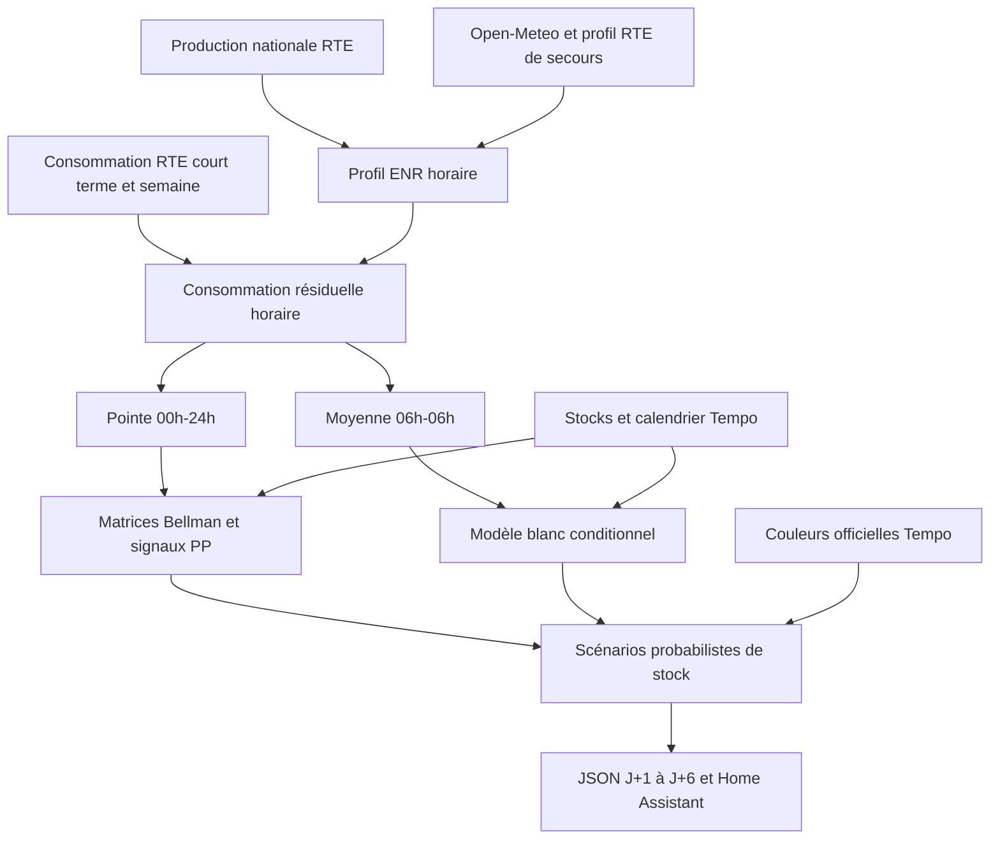

# Fonctionnement de Météo Tempo — V2.1.0

[Retour au README](../README.md) · [Format JSON](sortie_json.md)

## 1. Architecture

Il ne s'agit pas d'un apprentissage automatique. Le programme combine des prévisions physiques, des contraintes calendaires et des règles probabilistes explicites. RTE publie les seuils, mais le programme ne dispose pas des prévisions internes exactes qui seront utilisées lors de la décision future.

## 2. Acquisition et alignement des données

Les appels RTE utilisent OAuth. Les endpoints réellement utilisés sont :

| API | Endpoint sous `/open_api/` | Usage |
|---|---|---|
| Consumption | `consumption/v1/short_term` | Consommation à court terme |
| Consumption | `consumption/v1/weekly_forecasts` | Prévisions de semaine |
| Consumption | `consumption/v1/annual_forecasts` | Référence de normalisation des blancs |
| Generation Forecast | `generation_forecast/v3/forecasts` | Production nationale, types D-1,D-2,D-3 |
| Tempo Like Supply Contract | `tempo_like_supply_contract/v1/tempo_like_calendars` | Calendrier officiel et stock |
| Signal V2 | `signal/v2/signals` | Historique et annonces PP |

La granularité interne de récupération est le quart d'heure, avec agrégation par heure. À horodatage identique, le court terme prime sur la semaine. Les horodatages futurs de publication sont écartés. Le traitement en UTC et les bornes civiles `Europe/Paris` permettent de distinguer les heures répétées au changement d'heure.

La consommation résiduelle est calculée heure par heure :

`C_res(h) = C(h) - E_onshore(h) - E_offshore(h) - PV(h)`.

Le maximum horaire de cette série sur la journée civile sert au PP ; la moyenne de 06h à 06h du lendemain sert de base au blanc. En l'absence de fenêtre complète 06h–06h, le moteur utilise la moyenne civile lorsqu'elle est disponible. Le calcul nécessite des séries complètes pour la pointe et la moyenne civile ; une heure manquante ne devient pas un zéro fictif. La production et la consommation journalières affichées en MW sont des moyennes de puissance, pas des énergies en MWh.

## 3. Le nouveau modèle des rouges

### Les matrices officielles

À partir de l'hiver 2026–2027, la sélection des rouges Tempo suit le mécanisme PP dans les conditions décrites par RTE. Le programme charge les deux CSV de la période, dans son propre répertoire. Il ne recalcule pas l'équation de Bellman utilisée par RTE : il exploite les seuils publiés.

Chaque ligne des matrices contient `date`, `stockEpuise` (nombre de PP déjà consommés), `seuilBellman` (MW), `reason`. Un seuil positif fini est une valeur de comparaison ; `Infinity` bloque le tirage et `0` le force. Le chargeur vérifie dates, doublons, complétude de la matrice et cohérence du motif. Une matrice manquante ou invalide n'est pas remplacée par une matrice d'une autre année.

Les plages cumulées publiées pour 2026–2027 sont :

| Fin de mois | Minimum | Guide | Maximum |
|---|---:|---:|---:|
| Novembre | 0 | 1 | 3 |
| Décembre | 6 | 6 | 6 |
| Janvier | 13 | 16 | 19 |
| Février | 20 | 21 | 22 |
| Mars | 22 | 22 | 22 |

Ces nombres sont cumulés, pas des quotas mensuels indépendants. Le rappel vers le guide et les minima sont intégrés dans les matrices ; le code contrôle en plus les maxima et les réservations liées aux signaux PP futurs connus. Dans le code actuel, les jours PP éligibles sont les jours ouvrés de novembre à mars, hors jours fériés retenus et 24/31 décembre. Le dimanche est bleu dans le modèle, indépendamment de la tension (sous réserve d'une annonce officielle contradictoire).

### Du seuil à la probabilité

La pointe `P` est comparée au seuil `S` pour chaque scénario de stock. Le franchissement strict `P > S` est un diagnostic instantané. Pour anticiper la décision à venir, le modèle utilise une approximation gaussienne :

`p_PP = 0,5 × erfc((S - P) / (sigma × sqrt(2)))`.

L'écart type `sigma` est le maximum de 1 000 MW et de la pointe multipliée par le coefficient de l'horizon. Les coefficients J+1 à J+6 sont respectivement 2 %, 3,5 %, 5 %, 7,5 %, 9 % et 10,5 %. Lorsque les ENR ne viennent pas intégralement de RTE, 4 000 MW supplémentaires sont combinés quadratiquement. Ces valeurs sont des hypothèses, pas des erreurs mesurées. J-1 sert à la probabilité principale ; J-2 sert à un indicateur anticipé facultatif à J+2, et non à une seconde probabilité rouge à additionner.

### Signaux PP et couleurs officielles

Le calendrier Tempo publié prime sur toutes les estimations. La couleur du lendemain fournie par HA peut compléter le calendrier après 10h30 si celui-ci ne l'a pas encore renseignée. Un signal PP publié est pris en compte avant la couleur officielle. Un signal tardif (mise à jour à partir de 10h30 J-1, traitement spécifique de la période transitoire jusqu'à novembre 2027 dans le code) n'est pas assimilé automatiquement à un rouge confirmé. Le modèle ne prédit pas indépendamment les événements EcoWatt exceptionnels.

L'absence de signal ne signifie pas NON_PP. Le stock PP est suivi séparément du stock Tempo lorsqu'un historique PP complet est disponible ; sinon, le stock rouge Tempo sert de proxy, avec avertissement.

## 4. Scénarios de stock

La saison Tempo démarre le 1er septembre, avec 22 rouges, 43 blancs et le solde de jours bleus (300 ou 301 selon la durée de la saison). Le script réconcilie les stocks HA avec le calendrier complet lorsqu'il est disponible et tente de corriger les décalages d'un jour. Le stock initial représente la fin d'aujourd'hui, avant affectation de demain.

Pour chaque journée, le moteur conserve une distribution d'états `(PP consommés, rouges restants, blancs restants, bleus restants)` et propage la masse probabiliste vers les états du lendemain. Les états identiques sont regroupés. La somme des probabilités par couleur est arrondie à 1,000 quand les trois valeurs sont disponibles.

Exemple illustratif : un seuil mardi de 68,2 GW si lundi n'est pas PP, ou 70,7 GW si lundi l'est. Les deux scénarios contribuent au risque de mardi selon leurs poids. Ce n'est pas simplement la couleur favorite du lundi qui est retenue. Si des données manquent, des hypothèses internes de propagation (50 % pour une branche inconnue) permettent de continuer, mais les probabilités non justifiables sont masquées et le stock est marqué incertain. Ces poids de secours ne constituent pas des prévisions validées.

`red_remaining`, `white_remaining`, `blue_remaining` sont des compteurs de présentation décrémentés selon la couleur favorite ; ils ne décrivent pas toute la distribution. `expected_remaining` est l'espérance des stocks après le jour considéré ; `pp_thresholds` fournit les scénarios avant la décision. Plusieurs entrées peuvent partager le même seuil car les stocks blancs et bleus diffèrent.

## 5. Production renouvelable : nouveau modèle météo

RTE reste la source prioritaire. Les séries nationales éolien terrestre, offshore et solaire sont retenues ; les séries CPC/MDSE ne sont pas assimilées à la production nationale. Un ancien format `WIND` non ventilé peut être accepté en l'absence des deux séries éoliennes séparées ; dans ce cas, le mélange météo par filière n'est pas possible.

### Estimation horaire

Le modèle Open-Meteo est activé par `ENABLE_ENR_METEO`. Il utilise 20 points terrestres et 6 points maritimes. Les capacités de référence du code sont 24 500 MW terrestres, 2 300 MW offshore et 34 300 MW photovoltaïques, approximations continentales des statistiques SDES T3 2026. Les poids régionaux sont des proxys normalisés, et non des capacités vérifiées de parcs individuels.

- Éolien : vent à 100 m en m/s, courbe générique de puissance cubique entre 3 et 12 m/s, plateau au-delà et arrêt à 25 m/s. Facteurs globaux de 0,86 à terre et 0,90 en mer. Moyenne des puissances calculées aux deux extrémités de l'heure.
- Solaire : rayonnement global horizontal (`shortwave_radiation`), moyenne de l'heure précédente, coefficient global 0,80 et plafonnement à la capacité. L'orientation, les pertes et l'autoconsommation sont approchées, pas simulées site par site.
- Données horaires en UTC, sélection des cellules terre/mer séparée ; une couverture spatiale incomplète n'est pas extrapolée arbitrairement pour la filière manquante.

### Ordre de priorité

1. Heure complète RTE nationale ; sinon, assemblage de chaque composante RTE disponible et de la composante météo manquante.
2. Si l'heure nationale reste incomplète, moyenne des profils horaires complets RTE disponibles dans la réponse (jusqu'à trois profils récents, huit jours maximum). Un jour estimé n'est jamais recyclé comme profil RTE officiel.
3. Si aucune solution ne fournit une série complète, les valeurs dépendantes restent manquantes.

Ce secours n'est pas un cache persistant : en cas de panne de RTE, le script ne relit pas les réponses de l'exécution précédente. Le modèle météo ne remplace pas les prévisions de **consommation** manquantes.

## 6. Modèle des blancs et des bleus

Le modèle blanc est conditionnel à l'absence de rouge. Il utilise le Z calculé à partir de la moyenne nette Tempo, les stocks, la date de saison et des contraintes de fin de cycle. Le Z ne décide plus directement des rouges.

- Si au moins 30 valeurs de référence existent sur la fenêtre des 365 jours précédents, le code applique `(net - Q40) / (Q80 - Q40)` sur les données annuelles RTE reconstruites à partir de moyennes hebdomadaires.
- À défaut, `fallback_std` utilise `(net - 46050) / 2160`. Cette référence n'est pas calibrée sur la nouvelle méthode ; même la référence annuelle compare des données de nature différente (consommation brute de référence et consommation nette cible). Les anciennes catégories d'interprétation du Z ne sont donc pas garanties.
- La fonction logistique utilise un seuil inspiré de la méthode historique : `4 - 0,015*j - 0,026*(rouges + blancs) - 0,30`. Le dernier décalage, la pente et la dilution à longue échéance sont des choix propres au projet.
- `ENABLE_METEO` active un ajustement thermique distinct du modèle ENR. La température nationale pondérée est comparée aux normales disponibles dans le code ; le biais de 0 à 0,09 est appliqué au blanc conditionnel (signe selon le froid ou la douceur, puis bornage). Les mois non couverts n'ont pas de normale renseignée.
- `ENABLE_WHITE_BELLMAN` active un bonus expérimental de blanc quand la pointe approche un seuil PP fini (à partir de 85 %), pondéré par le Z et l'horizon. Il ne modifie pas directement la probabilité de rouge. Les seuils PP ne sont pas des seuils officiels de blanc.

Pour une branche non rouge, `p_blanc = (1 - p_rouge) × p_blanc_conditionnel` et le bleu reçoit le complément. La disponibilité des stocks et les dimanches imposent des contraintes supplémentaires. Les probabilités finales sont agrégées sur les scénarios.

## 7. Confiance, diagnostics et limites

Le score 1–5 part de la probabilité maximale, puis peut diminuer avec l'horizon (J+4 et suivants), l'estimation ENR ou l'incertitude des stocks. Les contraintes déterministes et annonces officielles ont un traitement spécifique. Le score n'est ni un taux de réussite ni une mesure validée de calibration. La carte enrichit les commentaires (duel, risque rouge, etc.) sans modifier le calcul.

`diagnostics.warnings` signale les échecs d'API, les problèmes de matrices et de stocks. Le code continue en cas d'échec partiel ; une erreur fatale est renvoyée dans `error`. La disponibilité de J+1 ne garantit pas J+6.

## 8. Évaluer et améliorer

La priorité est d'archiver chaque prévision avec son horodatage, son horizon, ses sources et la version du modèle, puis de la comparer à la couleur publiée et à la production ENR observée (par filière, en MW). Ne pas mélanger des prévisions émises après publication officielle avec de véritables prévisions. Pour les ENR, mesurer biais et MAE/RMSE horaires ; pour les couleurs, Brier score multiclasses et courbes de fiabilité par horizon, avec attention à la rareté des rouges. Comparer à des modèles de référence sur les mêmes dates. Aucun mécanisme automatique d'apprentissage ou d'archivage n'est implémenté dans la V2.1.0.
